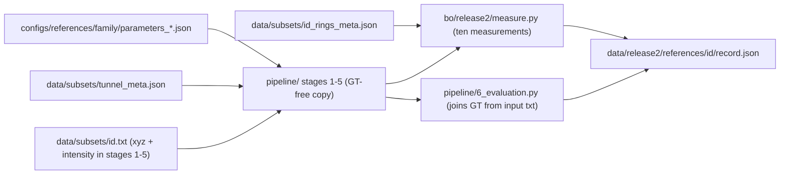

# Plan 1: GT-free pipeline, family references, single-instance gate

Budget: about 0.5 day (implementation 3-4 h; gate 3 runs x about 5 min, up to
2 h with one debug rerun per family).

## Goal

Build the code and configuration every later plan runs on, then prove one
reference run per family passes every validation requirement before any bulk
experiment starts.

## Findings that shape the plan

- The BO runner (`bo/runtime/pipeline.py`) executes `anchors/unified/*.py`,
  which is protected. The GT-free pipeline must be a new copy.
- The ring column is used in stage 1 only for the travel-direction flip under
  `canonical_orientation` (`corr(axis_proj, ring)`) and the
  `corr(h, ring) > 0.5` invariant (`anchors/unified/1_unfolding.py` lines
  134-146 and 899-907). The "orientation agreement" measurement
  (`orient_axis_corr` in `bo/runtime/intrinsics.compute_orient_axis`) is already
  label-free.
- Stage 5 writes `gt_labels` / `gt_rings` into `only_label.csv` for stage 6
  (`anchors/unified/5_sam.py` lines 903-908), so stages 1-5 currently carry the
  annotation columns through `df_point_cloud`.
- Expected ring count is hard-coded as 10 (`DEFAULT_RING` in
  `bo/sc_general/score_scaled.py`, `abs(ring_count - 10)` in
  `bo/sc_general/build_tables.py`); `data/subsets/<id>_rings_meta.json` exists for
  all 30 subsets with `n_rings_kept = 10`.

## Data flow

## Steps

### 1. Engineering metadata (45 min)

- `scripts/build_tunnel_meta.py`: for each parent tunnel 1..5 derive once the
  unit XY direction along which unfolded `h` must increase (current frame
  convention: `h_ring_sign` +1 for staggered and complex, -1 for continuous),
  check that all subsets of a tunnel agree in sign, and write
  `data/subsets/tunnel_meta.json`:
  `{ "1": {"h_axis_direction_xy": [dx, dy], "ring_length_m": 1.2, "inner_diameter_m": 5.5, "source": "..."} , ... }`.
- Document in `data/subsets/README.md` that this vector is derived once from
  the Seg2Tunnel ring index and thereafter treated as project metadata (drive
  direction), replacing the per-run ring read listed in the manuscript's
  `tab:dataset`.
- `bo/runtime/metadata.py`: `expected_rings(subset)`, `tunnel_meta(subset)`,
  `family_of(subset)` returning `staggered | continuous | complex`, and
  `panel_subsets()` / `dev_subsets()`.

### 2. GT-free pipeline copy `pipeline/` (1.5 h)

Copy `anchors/unified/{1_unfolding,2_denoising,3_enhancing,4_detection,5_sam,6_evaluation,family_io,t12_geometry,t3_geometry,t45_geometry}.py`
to `pipeline/`; anchors untouched. Changes:

- `1_unfolding.py`: `np.loadtxt(path, usecols=(0, 1, 2, 3))`; `df_point_cloud`
  has no `segment` / `ring`. Replace the `canonical_orientation` flip with:
  flip centres so that `(center2 - center1) . h_axis_direction_xy > 0`. Replace
  the `corr(h, ring)` exit with the label-free invariant of
  `compute_orient_axis` (|corr(h, PCA-axis projection)| >= 0.5, sign matching
  the metadata direction) and print
  `Canonical invariant (label-free): corr(h, axis)=...` for the intrinsics
  parser. Remove `h_ring_sign`; `random_seed`, `residual_recentre`,
  `theta_sign` unchanged.
- `5_sam.py`: `only_label.csv` holds `pred_labels`, `pred_rings` only.
- `6_evaluation.py` (offline): load columns 4-5 from `paths["input_txt"]`,
  assert row count equals `only_label.csv`, evaluate over all input points
  (denoised-out points count as background, per `sec:metrics`).
- `bo/runtime/intrinsics.compute_orient_from_unwrapped` already returns NaN
  when `ring` is absent; no change.

### 3. Family reference configurations (20 min)

- Copy `anchors/unified/params/2-1` to `configs/references/staggered/`,
  `3-1-1` to `continuous/`, `5-1` to `complex/`. Remove `h_ring_sign` and
  `swap_tunnel_centers` from `parameters_unfolding.json`.
- `configs/references/README.md`: source path, sha256 per file, date, and the
  statement that one file set applies to all ten subsets of its family.

### 4. Runtime wiring (1 h)

- `bo/paths.py`: `RELEASE2_DATA = REPO_ROOT / "data" / "release2"`,
  `PIPELINE_DIR = REPO_ROOT / "pipeline"`, `REFERENCES_DIR = REPO_ROOT / "configs" / "references"`.
- `bo/runtime/pipeline.py`: `SCRIPT_DIR = PIPELINE_DIR`; `make_env` exports
  `PROXY4TUN_TUNNEL_META`.
- `bo/release2/measure.py`: ten manuscript measurements with fixed names and
  expected ring count from metadata:
  PQ `unfold_residual`, `orient_agreement`, `denoise_retained_ratio`,
  `depth_nan_ratio`; SC `ring_count_error` (= |N_det - N_exp|, unnormalised),
  `boundary_explained_edge@25`, `correspondence_f1@15`, `chamfer_sym_px`,
  `sam_fill_rate`, `phase_incoherence_deg`. Reuses
  `bo/runtime/intrinsics.extract_intrinsics`, `bo/runtime/features`,
  `bo/sc_general/{replay,label_map,features}`. No proxy scoring here.
- `bo/release2/run_reference.py --subset ID [--overwrite]`: stages 1-6 with the
  family reference into `data/release2/references/<subset>/`, then
  `record.json` with `subset, family, params_sha256, overlay: {}, measurements,
  valid, gt_miou, elapsed_s, log`.
- `.gitignore`: un-ignore `data/release2/**/record.json`,
  `data/release2/**/*.md`, `data/release2/**/records/**`; run artifacts stay
  ignored.

### 5. Single-instance validation gate (45 min compute; up to 2 h with debugging)

Run `2-1`, then `3-1`, then `5-1` with `run_reference.py`. Each must pass
before the next family; all three before Plan 2. Expected wall time 5.6 / 4.0 /
4.5 min. One debug rerun per family allowed; a third attempt means stop and
report.

Pass criteria per run:

- stages 1-6 exit 0;
- stage-1 log shows the metadata orientation line and the label-free invariant
  with |corr| >= 0.5 and the expected sign;
- all ten measurements finite; `ring_count_error` computed against
  `n_rings_kept`;
- parity: GT mIoU within 0.01 of the release-1.0 reference (2-1 0.875,
  3-1 0.850, 5-1 0.818, `bo/runtime/spaces.UNIFIED_REF_MIOU`), since processing
  is unchanged and only the orientation source differs;
- `only_label.csv` has no GT columns; stage 1-5 logs show no ring-column reads.

Log in `data/release2/gate/GATE.md`: subset, exact command, measurement values,
mIoU vs reference, pass/fail per criterion, output paths, wall time per run.
The measured wall times replace the budget estimates in Plans 2-4.

## Out of scope

Sobol/GP sampler port, proxy fitting, degradation overlays, refinement arms,
stale-path cleanup in `bo/sc_general/` (each handled by the plan that first
needs it).

## To-dos

- [ ] tunnel-meta: `scripts/build_tunnel_meta.py`, `data/subsets/tunnel_meta.json`, `bo/runtime/metadata.py`, README note
- [ ] pipeline-copy: `pipeline/` GT-free stages 1-5, stage 6 joins GT from input
- [ ] family-refs: `configs/references/{staggered,continuous,complex}` with provenance
- [ ] runtime-wiring: paths, `bo/runtime/pipeline.py`, `bo/release2/measure.py`, `run_reference.py`, `.gitignore`
- [ ] gate-2-1: run and verify; start `GATE.md`
- [ ] gate-3-1-5-1: run and verify; complete `GATE.md` with wall times
