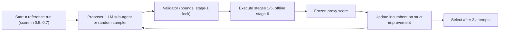

# Plan 4: self-refinement panel, benefit, selection, error analysis

Budget: about 3-4 days. Compute N x 4 arms x 3 attempts x 4.7 min (N = 22
gives 264 runs = 20.7 h GPU); LLM proposals 3 arms x N x 3 through the Cursor
interface, sequential within a case (attempt r+1 needs the executed result of
r), about 2-5 min each (7-16 h for N = 22, partly overlapping GPU time);
random arm negligible; benefit, selection, and error analysis about 0.5 day.
Prerequisite: Plan 3 reference runs and admitted list. N is whatever Plan 3
yields in `[0.5, 0.7]`; the budget scales linearly.

## Goal

For every admitted start, run four proposal arms (Fable 5.1, GPT-5.6,
Gemini 3.8, adaptive random search) with three sequential attempts each from
the same start under one proxy, validator, budget, execution code and
selector; then measure the GT benefit, compare selection policies on the same
executed pools, and analyse errors, all from the same new records.

## Protocol (from the instructions and `sec:agent-design`)

- Start: the subset's reference run (Plan 3). Admission: proxy score in
  inclusive `[0.5, 0.7]`.
- Each attempt: one overlay from the proposer; validate against the family
  bounds (`configs/bounds/<family>.json`, `bo/sc_general/overlay_validator.py`
  repointed); unfolding keys allowed only when the start residual exceeds
  10 cm; empty overlays rejected. Execute stages 1-5 (+ offline stage 6),
  score with `bo/release2/score.py`, record. Invalid or failed attempts
  consume the attempt and are excluded from selection.
- Incumbent update: only on strict improvement of the proxy score. The next
  proposal is made against the current best configuration with its
  intermediate outputs, measurements, ontology and previous feedback.
- Selection after three attempts: highest score among start and valid
  candidates; ties (within 0.01) retain the incumbent order (start first, then
  earlier rounds), i.e. the incumbent wins a tie. Pure max-proxy is reported
  as a policy too.

## Steps

### 1. Orchestrator `bo/release2/refine.py` (3 h)

Adapted from `bo/sc_general/run_fable_fresh_campaign.py`,
`refine_pilot.py`, `select_round.py`, `run_random_campaign.py`; all paths
repointed to `data/release2/refinement/<arm>/<subset>/round<r>/` and
`records/`. Commands:

- `--emit SUBSET --arm ARM`: write the GT-blind packet for the current
  incumbent (`packet.json`, allowed images, ontology path
  `agents/ontology/sam4tun_ontology.yaml`, four measurements, residual, family
  bounds, previous feedback). Never includes GT or `evaluation/`.
- `--apply SUBSET --arm ARM --round R --proposal-json FILE`: validate,
  execute, score, write `round<r>/record.json` (`overlay, valid, failure,
  measurements, score, band, residual, gt_miou (offline), elapsed_s`), update
  the incumbent, append to `records/candidates.csv`.
- `--finish SUBSET --arm ARM`: selection record in `records/selections/<arm>/<subset>.json`.
- `--status`: progress table.

### 2. Adaptive random arm (1 h)

- Frozen sampling distribution, fixed before any LLM attempt runs: the number
  of changed parameters k is drawn from the pooled empirical
  changed-parameter distribution of the three release-1.0 LLM arms (198
  records in `releases/1.0/exports/sc-general-random-evaluation/`, k > 0),
  frozen to `configs/random_arm.json` with seed base 20260915; values uniform
  within family bounds; unfolding keys only when stage 1 is unlocked.
- Adaptive: each attempt is a sparse overlay applied on top of the current
  best configuration (not the start), consistent with the strict-improvement
  update.
- Decision to confirm before execution: using the release-1.0 pooled k
  distribution keeps the random arm independent of the new LLM runs;
  deriving k from the new LLM arms instead would require running them first.

### 3. LLM arms through the Cursor interface (7-16 h interface time)

For each admitted case and each arm, the parent agent: emits the packet;
launches a fresh sub-agent with the arm's model slug
(`claude-fable-5-1-thinking-high`, `gpt-5.6-sol-medium`, `inherit` for
Gemini 3.8) with the fixed prompt skeleton and required JSON schema
(`observation, rule, failure_mode, rationale, overlay, full`); applies the
proposal; resumes the same sub-agent with the executed result and proxy
feedback for attempts 2 and 3. Prompts, raw responses, and sub-agent ids are
stored under the round directory. One case at a time per arm; GPU work
serialised through a single apply queue (adapted
`apply_fable_fresh_queue.py`).

### 4. Single-instance gate (30 min)

One admitted case, random arm, all three attempts (no LLM cost). Pass: three
valid or explicitly failed records, incumbent updates only on strict
improvement, selection JSON matches the rule, packet contains no GT fields,
wall time within budget. Then one LLM attempt (Fable 5.1) on the same case:
proposal parses and validates, record written. Log to
`data/release2/refinement/GATE.md`.

### 5. Bulk panel (20.7 h GPU for N = 22)

Order: random arm for all cases first (fills the GPU queue without interface
time), then Fable 5.1, GPT-5.6, Gemini 3.8. Every attempt executed; no early
stopping; failures recorded with reason.

### 6. Benefit `bo/release2/analyse_benefit.py` (2 h)

After all selections are frozen: GT mIoU over original points including
background (stage 6). Per arm: starting and selected means; mean paired gain
with parent-tunnel bootstrap 95 % intervals (5 clusters, 100 000 resamples,
fixed seed; `bo/runtime/clustered_stats.py` and
`bo/sc_general/selector_policies.py` logic repointed). Family means; means
over all 27 subsets (non-admitted cases carry their start); retrospective
initial-GT strata below 0.5, `[0.5, 0.7]`, above 0.7. Secondary: medians,
improved / unchanged / harmed counts at three decimals, worst loss. Output
`data/release2/analysis/benefit.md` and `numbers.json`.

### 7. Selection policies (1 h)

On the same executed pools per arm: start only; first round; uniformly chosen
round (mean over the three rounds, failed rounds counted as the start with a
flag); maximum proxy including the start; offline GT oracle. Report policy
means, oracle recovery, regret (oracle minus selected GT). Failed rounds
listed explicitly. Output `analysis/selection.md`, `records/policies.csv`.

### 8. Error analysis (1.5 h)

From the same records: proposals with proxy above the start (count, per arm);
proportion of those also improving GT mIoU; final band transitions of the
retained output (flag / refine / accept); mean point-error fractions
(correct, FN, FP, swap) for start vs selected from `only_label.csv` plus GT
columns from the input txt (adapted `bo/sc_general/error_analysis_publish.py`,
numbers only, no figures). Output `analysis/errors.md`, merged into
`numbers.json`.

## Deliverables

- `data/release2/refinement/records/{panel.csv,candidates.csv,policies.csv,failures.csv}`, `selections/<arm>/*.json`, `GATE.md`.
- `data/release2/analysis/{benefit.md,selection.md,errors.md,numbers.json}`.
- `configs/random_arm.json`.

## To-dos

- [ ] orchestrator: `bo/release2/refine.py` emit / apply / finish / status
- [ ] random-arm: frozen k distribution, adaptive sampler, `configs/random_arm.json`
- [ ] gate-refine: random arm three attempts + one Fable attempt on one case, `GATE.md`
- [ ] bulk-random, bulk-fable, bulk-gpt56, bulk-gemini38
- [ ] benefit: paired gains, parent-tunnel bootstrap, family / all-27 / strata
- [ ] selection: five policies, oracle recovery, regret
- [ ] errors: yield, accepted precision, band transitions, point-error fractions
